# Hybrid Drone-Car Motherboard Project

Here is the step-by-step design, layout, and optimization process for my dual-mode flying car motherboard.

### 🖼️ Design and Layout Progress Logs

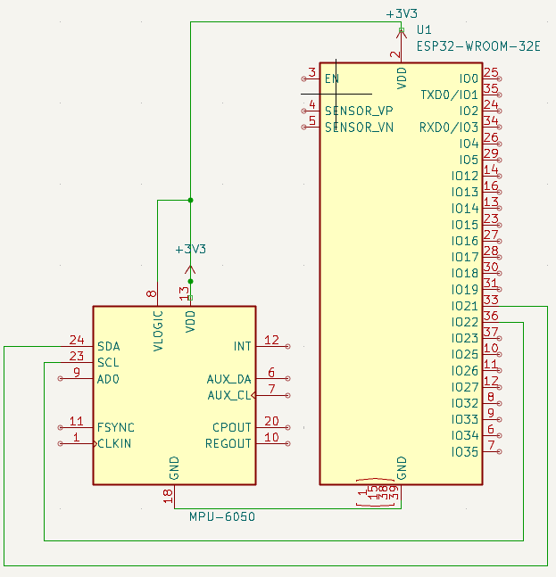
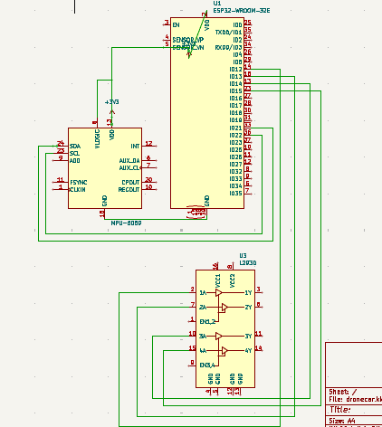
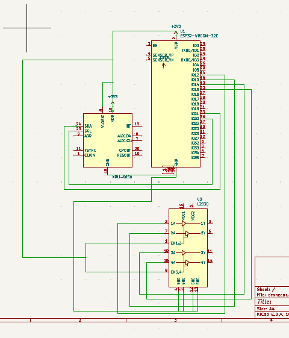
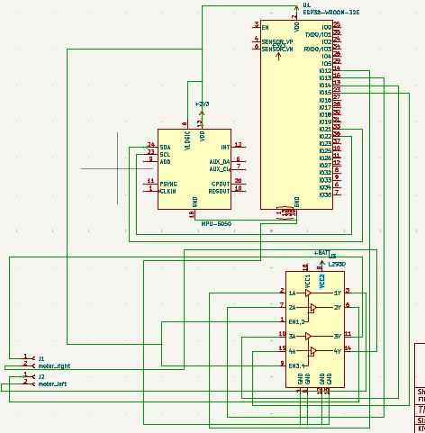
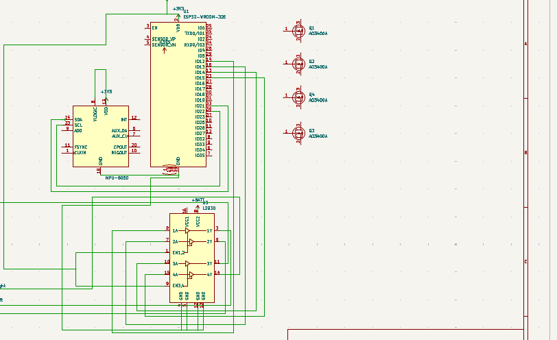

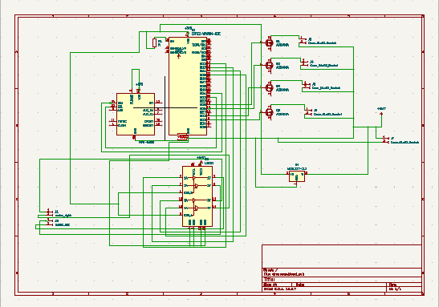
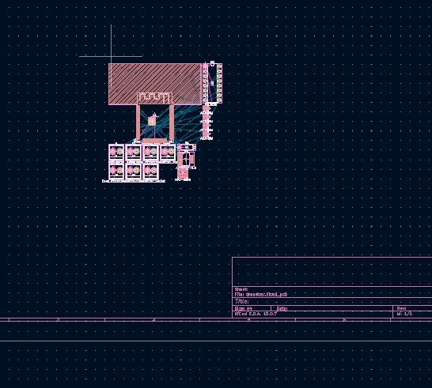
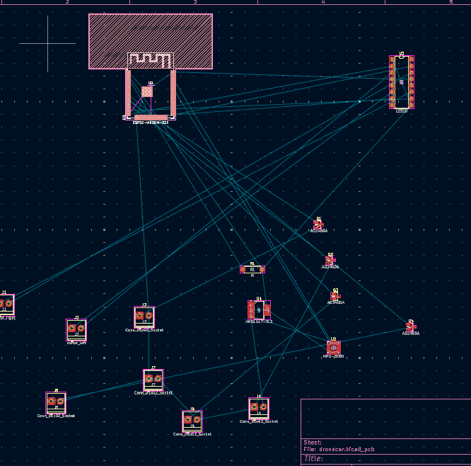
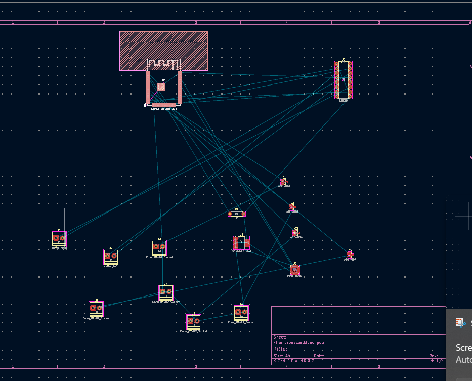
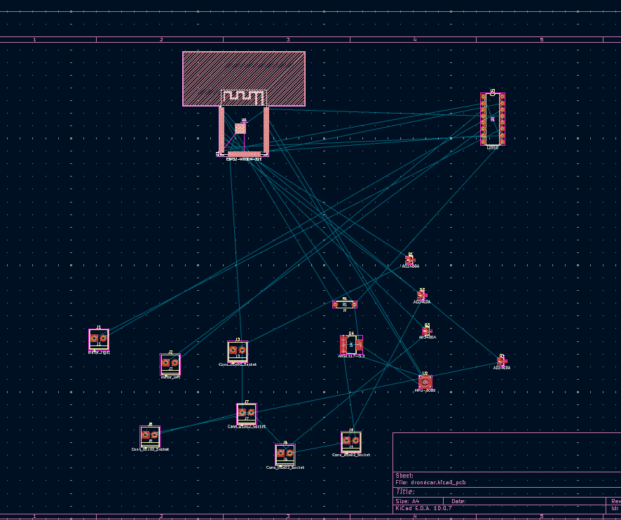
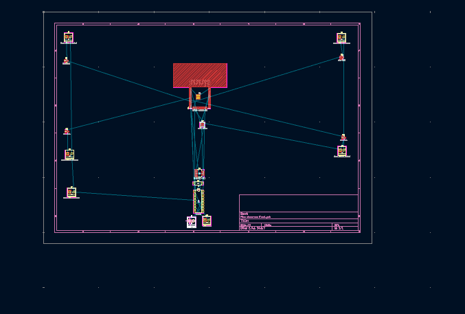
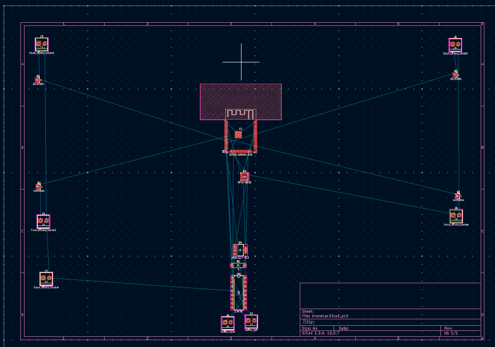
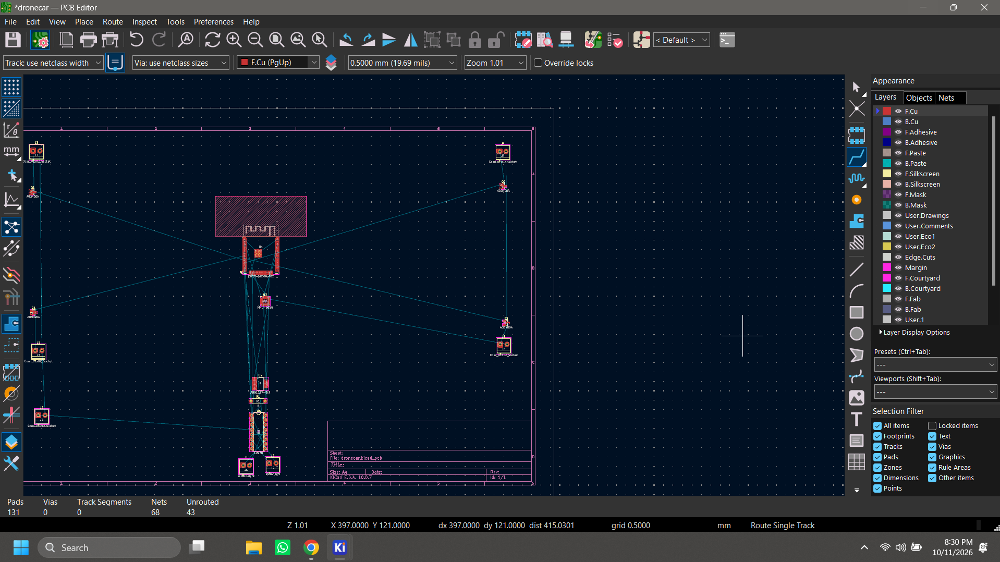
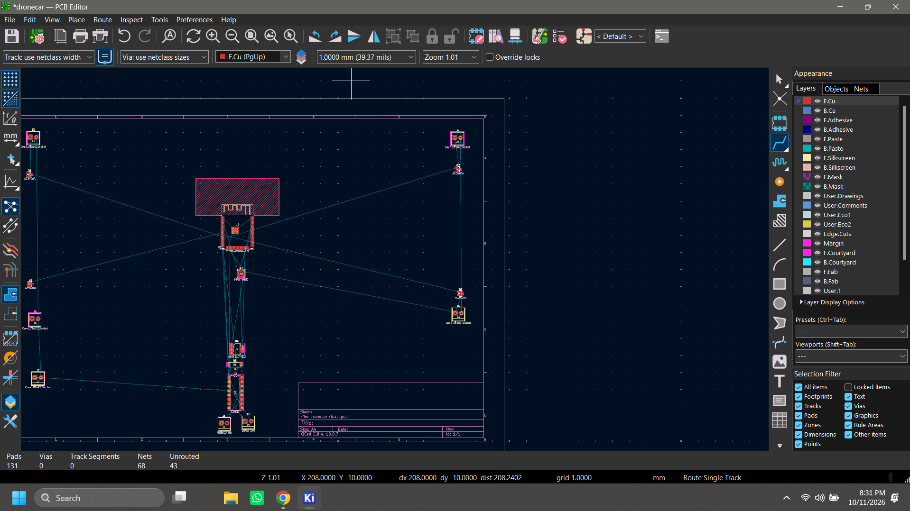

